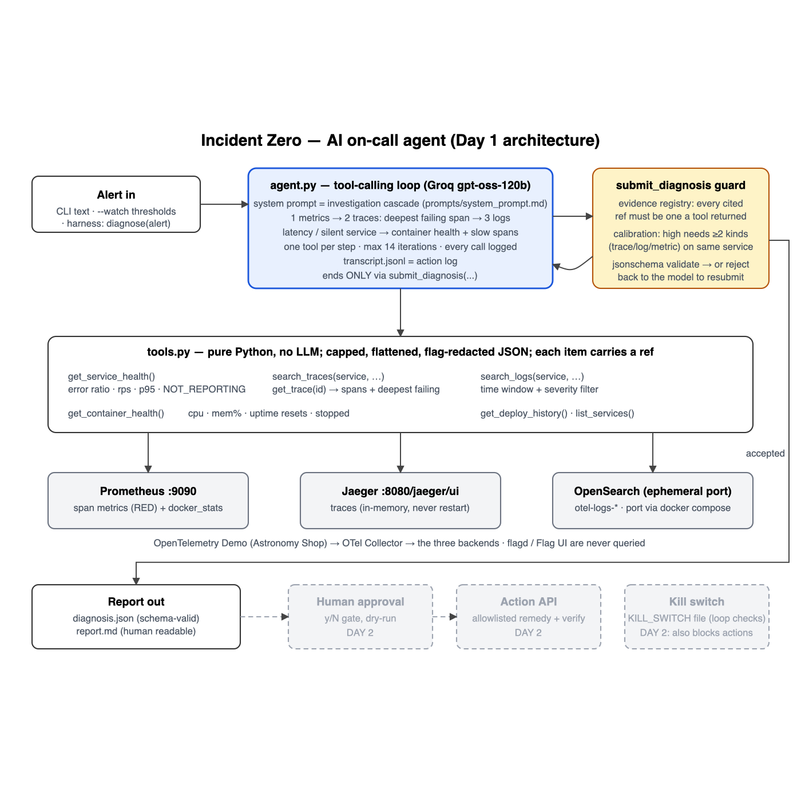

# TEAM-33 · Incident Zero — AI On-Call Engineer

> **Day 2 status**
> - **Works (verified live):**
>   - alert → diagnosis → reviewer → dry run → human `y` → act → **verified recovery** (`currency-stopped`: restart; `payment-failure`: write-only flag fix, deviation 20 → 0);
>   - human `n` changes nothing;
>   - `KILL_SWITCH` stops a run with 0 actions;
>   - an invented `trace-9999` is rejected live.
> - **Measured:** confidently-wrong answers **3 → 0**; the *high*-confidence band went from 50% to 100% accurate (small sample). After-sweep: 4/8 correct, 2 honest escalations, 2 wrong at medium. See `evaluation-note.md`.
> - **Doesn't work yet / not measured:** Kafka incidents. The last fixes (infrastructure consistency check, windowed restart loop) aren't yet measured, because Groq's free tier allows 200k tokens per model per day and one investigation costs 20–35k.
> - **First thing to do:** get a higher-limit key (the organisers', or `API_KEY_FALLBACK` from another account), then run `python run_all.py` to measure the final code on all 12.
> - **Before the demo:** `python check_stack.py --fix` must say ALL GREEN; follow `docs/demo-script-day2.md`.

An agent that takes a production alert on the OpenTelemetry Demo and does the on-call engineer's first hour:
1. **Investigate** with real telemetry tools (metrics, traces, logs, container health).
2. **Name the component that is actually broken**, proven with evidence a tool really returned, with a confidence that is calibrated in code.
3. **Let a second model try to disprove** the diagnosis.
4. **Show a dry run**, then **wait for a human to type `y`**.
5. **Act through an allowlist**, and **verify recovery** against numbers captured before acting.
6. **Roll back and escalate** if the fix didn't work.

When it isn't confident, it **escalates with its findings** instead of guessing.

**Nothing changes without a human yes. Nothing is called fixed without a before/after comparison.**



The detailed data-flow map (where each piece of data is stored, the exact endpoint the agent fetches it from, and every file written to disk) is [docs/architecture-detailed.png](docs/architecture-detailed.png).

## Quick start

```bash
# 1. the demo stack in FULL mode (the Kafka faults need it). Not `make start`: see SETUP_NOTES.md
cd ../opentelemetry-demo
docker compose --env-file .env --env-file .env.override -f compose.yaml -f compose.full.yaml \
  -f compose.observability.yaml -f compose.extras.yaml up -d --remove-orphans
cd -

# 2. this repo
python3.11 -m venv .venv && .venv/bin/pip install -r requirements.txt
# .env.local (git-ignored):  export API_KEY="..."   export BASE_URL="https://api.groq.com/openai/v1"
#                            export MODEL_NAME="openai/gpt-oss-120b"
#   optional backup key:     export API_KEY_BACKUP="..."    (a second account, used only when the primary is daily-capped)
#   optional fallback:       export API_KEY_FALLBACK="..."  export MODEL_NAME_FALLBACK="..."
.venv/bin/python check_stack.py          # pre-flight: every data source fresh -> ALL GREEN
.venv/bin/python smoke_test_llm.py       # key + tool calling -> PASS
.venv/bin/python tests/test_offline.py   # 20 tests, no stack, no LLM

# 3. the full loop on a live fault (Checkpoint 3): diagnose -> review -> dry run -> you approve -> act -> verify
./demo.sh                                # currency-stopped: restart_service, verified recovery
```

Every run writes `runs/<incident_id>/` (or `reports/demo/…` from `demo.sh`):
- `diagnosis.json`: the schema-valid result.
- `report.md`: the readable report, including the reviewer verdict and the action loop.
- `transcript.jsonl`: every LLM reply (with the model and its token usage), every tool call and result, every submission, the review and the action loop.

Every action attempt, including refusals and dry runs, is appended to `action_log.jsonl`.

## Commands

| Command | What it does |
|---|---|
| `python agent.py "<alert>"` | **Full loop:** diagnose, reviewer, dry run, `approve? [y/N]`, act, verify, roll back if needed |
| `python agent.py "<alert>" --dry-run` | Diagnose and show exactly what *would* change. Never acts. |
| `python agent.py "<alert>" --no-act` | Diagnose only (what the practice sweep and the hidden test measure) |
| `python agent.py "<alert>" --demo-hallucination` | **Demo only:** plants one fake evidence ref (`trace-9999`) so the guard visibly rejects it and the model resubmits with real evidence |
| `python agent.py "<alert>" --yes` | **Unattended runs only:** auto-approves the proposed action. Printed as a warning, and recorded as `auto-approve (--yes…)` in the report and the action log. Not used by any demo or test path. |
| `python agent.py --watch` | Detect: polls service health and starts the loop when a service shows ERRORS, SLOW or NOT_REPORTING |
| `touch KILL_SWITCH` / `rm KILL_SWITCH` | **Kill switch:** stops an investigation at the next step, refuses every action, aborts verification |
| `./demo.sh [incident] [alert] [flags]` | Checkpoint run: pre-flight, inject, wait 120 s, full loop, action log, reset |
| `python check_stack.py [--fix]` | Pre-flight; `--fix` restarts a collector whose span metrics froze |
| `python run_all.py [incident…]` | Practice sweep (diagnosis only): inject, wait, diagnose, score, `verdict.json`, reset |
| `python calibration.py` | Stated confidence vs actual accuracy across every sweep |
| `python tools.py <tool> [args]` | Any telemetry tool by hand, no LLM (e.g. `python tools.py get_service_health 5`) |
| `python actions.py describe <action> <target>` | Dry run of one action from the shell |
| `python report.py runs/<id>/diagnosis.json` | Validate against `schema.json` and print the readable report |
| Harness | `from agent import diagnose, handle_incident`: `diagnose(alert)` returns the dict and never acts |

## How the approval gate works (GATE 2)

1. The agent only proposes a change when the diagnosis is `diagnosed` with confidence of at least 0.5. Otherwise it escalates with no action.
2. It prints the diagnosis, the reviewer's verdict, and a **dry run** from `actions.describe()`: the exact command, its effect, and how it would be undone. Nothing has changed at that point.
3. It asks `Approve this action? [y/N]` on the terminal. Only `y` or `yes` approves. **No terminal (stdin closed) counts as "no".**
4. `approved=True` is set in exactly one place, that prompt. `actions.execute()` refuses anything without it, and logs the refusal.
5. The approver (OS user) and the time are written to the report and to `action_log.jsonl`.

## How the kill switch works (GATE 4)

`touch KILL_SWITCH` in the repo folder, and it is checked:
- before every investigation step;
- before the dry run and again after the human answers;
- inside every `actions.execute()` call;
- every second of the verification wait. A kill switch created during verification also blocks the rollback.

Remove the file (`rm KILL_SWITCH`) to clear it. `check_stack.py` flags a leftover one.

## The four safety gates

| Gate | Where | What it guarantees |
|---|---|---|
| 1 · Reviewer | `agent.review_diagnosis` | A second LLM call, prompted to *disprove* the diagnosis, sees the evidence and how far each service moved from its own baseline. **DISPUTED** caps confidence at 0.60. Its verdict is in every report, agree or not. |
| 2 · Human approval | `agent.act_on_diagnosis` | Dry run first, then `y/N`. Nothing changes without an explicit yes. |
| 3 · Allowlist | `actions.py` | Only `restart_service`, `toggle_feature_flag`, `throttle_load` (and `scale_service`, which is refused on Compose). Protected: jaeger, prometheus, opensearch, otel-collector, grafana, flagd, flagd-ui, load-generator, and anything outside the demo's compose project. Every call is logged. |
| 4 · Kill switch | `KILL_SWITCH` file | See above |

**After acting**, `verify.py` compares the root-cause service's **deviation from its own baseline** before and after:
- It waits 120 s, then reads a fresh 2-minute window. Prometheus lags up to about 2 minutes, so an earlier check would read the old window.
- One re-check before declaring failure.
- "Cannot tell" is reported as `None`, never as success.

If recovery isn't confirmed, the inverse action runs (for example, restoring the load generator's captured user count) and a human is called. If no safe inverse exists, the report says so and escalates.

### Feature flags: reading is forbidden, writing is allowed (and we keep them apart)

- **The diagnosis path cannot read feature flags.** No tool touches flagd, the Flag UI or the flag file. The flag services are hidden. Telemetry text or attributes naming a feature flag are redacted in the tool layer before the model sees them.
- **The action path can only write a flag**, with a flag name that **the human supplies at approval**: the agent can't know flag names, because it never reads them.
  - The write uses the same Flag-UI mechanism as the practice injector: a whole document built from the repository's pristine defaults with one flag changed.
  - The dry run states the side effect: every other flag returns to its default.
- **No code reads a flag to decide anything.**

## How the agent decides (the investigation policy, `prompts/system_prompt.md`)

1. **Metrics first:** `get_service_health` ranks every service by `deviation_score`, meaning how far it has moved from **its own** last-hour baseline. A service that went silent is down (NOT_REPORTING, listed first). If span metrics have frozen, the tool says so (`pipeline_warning`) instead of looking healthy.
2. **Errors → traces:** the root cause is **the deepest erroring span whose own children did not error**, computed in Python (`find_deepest_failing_spans`). A "can't reach X" error blames X only if X is actually unhealthy.
3. **No errors → the twin rule:** the root cause is **the service or container that moved furthest from its own normal**, not the slowest one.
   - `accounting` always sits at about 15 s (a Kafka batch consumer), so its deviation is 0 and it's never the answer.
   - `ad` at 10× its usual CPU is.
   - `get_container_health` flags NOT_RUNNING, OOM_KILLED, CRASHED_AND_RESTARTED, RESTART_LOOP, CPU_SPIKE, MEMORY_HIGH / MEMORY_CLIMBING (against the container's own baseline) and CPU_LIMITED.
4. **Logs** for that service and window give the cause in words.
5. **Converge or escalate.**

### Honesty controls in code (not in the prompt)
- **Evidence registry:**
  - every returned item gets a ref;
  - a ref no tool returned in this run is rejected, and the model resubmits;
  - the report embeds the registry's copy, never the model's retelling;
  - evidence older than 10 minutes doesn't count.
- **Calibration:**
  - *high* needs two evidence kinds naming the service, and the service must be among the most-changed services (otherwise capped at 0.70);
  - an escalation is capped at 0.45;
  - the reviewer's dispute caps at 0.60.
- **Always-valid output:** if the budget runs out, the agent escalates honestly in schema-valid JSON.

### Robustness
- **Groq limits:**
  - pacing keeps us under 8,000 tokens per minute;
  - Groq's "try again in Xs" is honoured;
  - old tool results are compacted, keeping every ref;
  - a daily cap walks a route list, each (key, model) pair having its own quota: `gpt-oss-120b` on the primary key → `gpt-oss-120b` on the backup key (`API_KEY_BACKUP`) → `gpt-oss-20b` on the primary key → `gpt-oss-20b` on the backup key. A capped route rests for the cool-down Groq names (at least 10 min), then the agent goes back to the best free route.
  - The transcript records which model answered every call.
- **Tool failures:** a tool exception becomes `{"error": …}` for the model and never kills the run.
- **Stack health:** `check_stack.py --fix` and the sweep pre-flight restart a collector whose Prometheus export froze. This happened to us after about 3 hours of uptime.

## Files

| File | Role |
|---|---|
| `agent.py` | Tool descriptions, the tool-calling loop, the `submit_diagnosis` guard, reviewer, act-and-verify loop, CLI, `--watch`, `diagnose()` / `handle_incident()` |
| `tools.py` | Seven telemetry tools and the evidence registry. Pure Python, **no LLM import**. |
| `actions.py` | **The Action API:** allowlist, dry run, approval-gated execute, protected containers, inverse map, `action_log.jsonl` |
| `verify.py` | Before snapshot, wait, fresh-window comparison, re-check, `None` = cannot tell |
| `llm.py` | The only file that talks to the LLM: pacing, retry-after, fallback model, usage logging |
| `config.py` | The only place URLs, ports and models are written; discovers the ephemeral OpenSearch and load-generator ports |
| `prompts/system_prompt.md` | The investigation policy |
| `schema.json`, `report.py` | Output schema (provisional), validation, readable report |
| `check_stack.py`, `calibration.py`, `run_all.py`, `demo.sh`, `run_day1.sh` | Operator tooling (the agent never calls these) |
| `practice/` | Stand-in faultctl and the practice incidents. Expected answers are read **only** by the scorers. |
| `tests/test_offline.py` | 20 tests: evidence guard, calibration, stale evidence, deepest span, flag redaction, baselines, DOWN vs IDLE, the infrastructure consistency check, grounded reviewer disputes, API-rejected tool calls, and every action-loop path (approve, reject, dry run, kill switch, low confidence, recovery, rollback, hallucination demo) |
| `docs/` | `architecture.png` (one page), `architecture-detailed.png` (data-flow map), `flow.png`, `TEAM_SPLIT.md`, `mentor-walkthrough.md`, `demo-script-day2.md`, `DAY1_REPORT.md`, `kickoff-and-mentor-questions.md` |
| `reports/` | Every sweep (scoring table, `verdict.json`, transcripts) and the checkpoint runs |
| `evaluation-note.md` | What it got right and wrong, before and after the fixes, plus the calibration table |

## Known limitations (stated plainly)
- **`schema.json` is provisional.** The organisers' schema wasn't in our kit. Swap it in verbatim and align the field names in `build_diagnosis`.
- **`practice/faultctl.py` is a stand-in** for the organisers' faultctl. Its 12 incidents mirror the brief's examples, not the official 10. Injection is behind one function in `run_all.py`.
- **`get_deploy_history` is a stand-in** built on `docker inspect`.
- **`scale_service` is not supported:** it needs Kubernetes and this is Docker Compose. It's refused with that reason, not faked.
- **Not every fault has an allowlisted fix:**
  - a restart doesn't remove an external CPU limit or a restart loop driven from outside;
  - flag-driven faults (e.g. `adHighCpu`) come back after a restart.
  - In those cases verification reports "not recovered" and the agent escalates. That's the intended, honest outcome.
- **Flag toggling has no automatic rollback**, because restoring the previous variant would mean reading flag state. A failed flag fix escalates instead.
- **Kafka incidents are the weakest area:** consumer lag isn't exposed as a metric the tools read, so the agent relies on fraud-detection/accounting traces and logs.
- **Rate limits (the biggest operational risk):** Groq's free tier allows 8,000 tokens/minute **and 200,000 tokens/day per model**. One investigation costs about 20–35k tokens, so each model handles roughly 6–8 investigations a day. Pacing handles the per-minute limit. A daily cap switches to the backup key's 120b first, then to the smaller model, and back once the cap clears; with two keys that is about 4× one model's daily budget. Both models capped out during our overnight testing. **For the hidden test, use a key with a higher limit** (the organisers', or `API_KEY_FALLBACK` from another account).
- **Collector freeze:** span metrics stopped once after about 3 hours. The tool reports it (`pipeline_warning`) and `check_stack.py --fix` repairs it, but the cause is upstream.

## Team

- Tarun
- Devaki

See `team-form.md` for who built which part and every AI model and assistant used, and `docs/TEAM_SPLIT.md` for roles.
