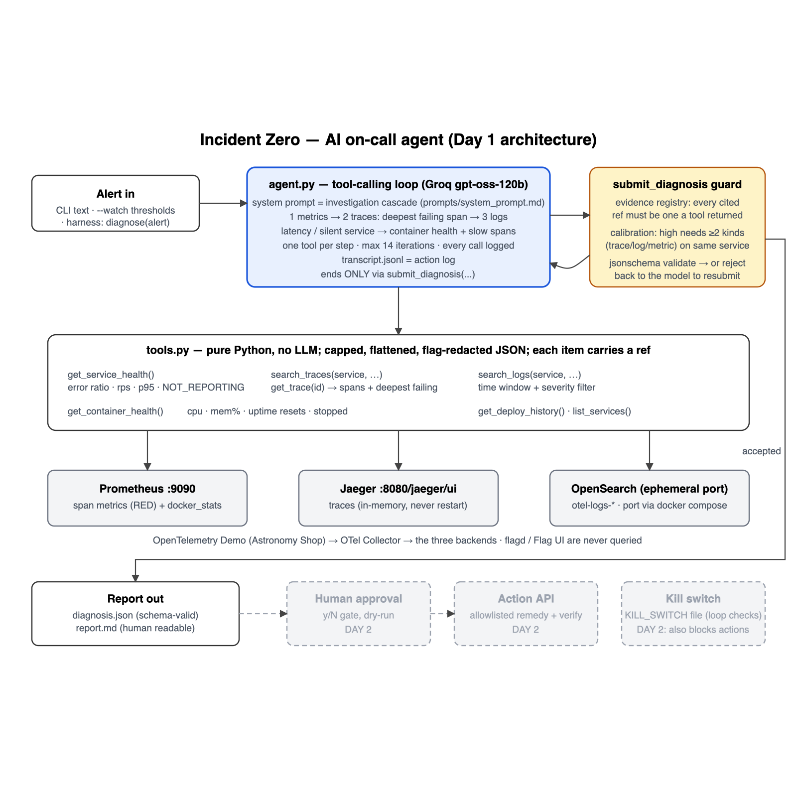

# TEAM-33 · Incident Zero · Day 1 report

**Event:** Incident Zero: Build an AI On-Call Engineer (Bosch × PES University), Day 1, 23 Oct 2026, 11:30–18:45
**Team:** Tarun, Devaki (see `team-form.md`)
**Repository:** `TEAM---33` (remote `github.com/1Monish8/TEAM---33`), local commits not yet pushed
**Status when written:** 16:59. Agent built and verified live; practice sweep 3/3 passing so far (in progress).

---

## 1. Summary

We built an AI on-call agent for the OpenTelemetry Demo ("Astronomy Shop"). It receives an alert and investigates with real telemetry tools (metrics, traces, logs, container health, recent changes). It names the component that is **actually** broken, not the service the alert named. It cites only evidence that a tool really returned, says how confident it is, and proposes one allowlisted remedy for a human to approve. When it isn't confident, it escalates with its findings instead of guessing.

The three design decisions that matter most:

1. **The deepest failing span is the root cause.** It's computed in Python, not left to the model. When `paymentFailure` is on, five services report errors; only `payment` is broken.
2. **Invented evidence is structurally impossible.** Every item a tool returns gets a reference. The final answer may cite only those references, and code (not the prompt) rejects anything else.
3. **Confidence is calibrated in code.** "High" needs two independent kinds of evidence; otherwise confidence is capped. An honest escalation is a first-class outcome.

### Day 1 milestone status

| Milestone (from the brief) | What it requires | Status |
|---|---|---|
| Kickoff | Capture the schema, Action API, faultctl, deploy history, template, key | ⚠️ Captured. The schema, faultctl, Action API and deploy history were **not** in our kit, so we built clearly marked stand-ins (§9). |
| Setup → Checkpoint 0 | Demo running with load, faultctl inject/reset, LLM key works, repo forked, all members committed | ✅ Demo (28 containers, full mode), inject/reset (stand-in faultctl), LLM smoke test PASS, repo exists. ⚠️ Commits from Tarun and Devaki only; any other member must commit; not yet pushed. |
| "The agent can see" → Checkpoint 1 | Tools for logs, metrics, traces, deploy history; live run on one incident; one-page architecture sketch | ✅ 7 tools verified against the live stack; live run correct (`reports/checkpoint1/`); `docs/architecture.png` and `docs/flow.png` |
| "The agent can diagnose" → Checkpoint 2 | Root cause with evidence and confidence, in the JSON schema; correct on ≥3 practice incidents | ✅ Schema-valid output with registry-checked evidence and calibrated confidence. Sweep so far: payment, cart and product-catalog all correct (§11). |
| Day 1 wrap-up | Code saved, evaluation note, system prompt as a file, README handover, tag | ⏳ System prompt saved as `prompts/system_prompt.md`. Evaluation note, README handover and the `day1-end` tag follow the sweep. |
| Minimum by checkpoint (Day 1) | "An agent that uses tools and correctly diagnoses practice incidents with real evidence" | ✅ Met so far |

---

## 2. Event brief and how we are scored

| Part | Points | What earns it |
|---|---|---|
| Checkpoint 1: Eyes | 10 | Tools that see; live run; architecture sketch |
| Checkpoint 2: Brain | 20 | Correct diagnosis with evidence and confidence on 3 incidents the mentor picks |
| Checkpoint 3: Hands (Day 2) | 20 | Allowlisted action, approval gate, recovery verified, dry run, kill switch |
| Checkpoint 4: Hidden test | 30 | Unseen incidents, scored automatically, **on the same diagnosis engine we built on Day 1** |
| Judges | 20 | Safety and human approval, agent design and tool use, explainability, testing and honesty, demo |

About 60 of the 100 points depend on Day 1 work: Checkpoints 1, 2 and 4, plus most of the judges' criteria.

**Rules we designed around:**
- Diagnosis must come from telemetry; reading feature-flag settings means disqualification.
- No hard-coded answers.
- The agent changes the demo only through the Action API, and only after human approval.
- Invented evidence is penalised.
- An honest escalation scores better than a confident wrong fix.
- Stating a limitation costs nothing; hiding a failure loses points.

---

## 3. Environment and setup: what actually happened

| Item | Outcome |
|---|---|
| Laptop | macOS, 16 GB RAM (Docker Desktop has 7.6 GB), 10 CPUs, 141 GB free disk |
| Toolchain | Docker 29.2.1, Compose v5.1.0, Python 3.11.15, git 2.39 |
| Network | `github.com` blocked on the venue network; `codeload.github.com` works, so the demo was fetched as a tarball. The image registries (ghcr.io, Docker Hub, quay.io) kept failing with TLS handshake timeouts. |
| Images (about 14 GB, 28 images) | Parallel pulls kept failing. Pulling **one image at a time with retries** got all 28. |
| Demo stack | Full mode (Kafka, accounting and fraud-detection are needed for the Kafka faults). It uses about 5.5 GB. Started with `docker compose … up -d --remove-orphans`, **not** `make start`: its `--force-recreate` races Kafka's slow start (also in `SETUP_NOTES.md`). |
| LLM | Groq `openai/gpt-oss-120b` through the OpenAI-compatible API; key in `.env.local` (git-ignored). Smoke test PASS. |
| Stack location | `/Users/taruns/Downloads/bosch/opentelemetry-demo` (full mode). **Only one stack may run** (see §12, issue 6). |

### Endpoints verified by hand (runbook step 6)

| Source | Where | Verified facts |
|---|---|---|
| Web store | `http://localhost:8080/` | 200 |
| Jaeger | `http://localhost:8080/jaeger/ui/api/v3/...` | **Only v3 works**; `/api/traces` is a 404. OTLP JSON (`resourceSpans → scopeSpans → spans`), `status.code == 2` means error, times in nanoseconds, exceptions in span events. The v3 search **ignores attribute filters**. |
| Prometheus | `http://localhost:9090` | `traces_span_metrics_calls_total`, `traces_span_metrics_duration_milliseconds_bucket`; `status_code="STATUS_CODE_ERROR"`. Container metrics: `container_uptime_seconds`, `container_cpu_utilization_ratio`, `container_memory_usage_total_bytes`, `container_memory_usage_limit_bytes`. **No restart counter.** |
| OpenSearch | ephemeral host port (`docker compose port opensearch 9200`) | Index `otel-logs-YYYY-MM-DD`. Fields: `body`, `resource.service.name` (text plus `.keyword`), `@timestamp`, `severity.text` / `severity.number`, `traceId`. |
| Grafana / Locust | `/grafana/`, `/loadgen/` | 200. Default load is 5 users, about 1.5 requests per second. |
| Flag UI | `/feature` | **Never used for diagnosis.** Used only by the practice injector, the way a person would click it. |

---

## 4. Architecture



Full flow, including the investigation policy: `docs/flow.png`.

```
alert ─► agent.py loop ─► llm.py (Groq) picks ONE tool ─► tools.py runs it on real telemetry
          ▲                                                   │ summarise · cap · redact flags · register refs
          └──────────── result + ref appended, logged ◄───────┘
model calls submit_diagnosis ─► guard (refs real? evidence names service? calibration? schema?)
          ├─ rejected → reason back to model (max 3)
          └─ accepted → diagnosis.json + report.md + transcript.jsonl
budget exhausted → automatic honest escalation (always valid JSON)
Day 2: human approval y/N → Action API (allowlisted) → verify recovery / roll back
```

---

## 5. Repository contents (file by file)

| File | Lines | Role |
|---|---|---|
| `config.py` | 54 | The only place URLs, ports and the model are written. Discovers OpenSearch's ephemeral port each run. Reads `.env` / `.env.local`. |
| `llm.py` | 63 | The only file that talks to the LLM (OpenAI SDK pointed at Groq). Retries transient network, rate-limit and server errors with back-off: 5, 15, 30, 60, 90 s. |
| `tools.py` | ~670 | Seven telemetry tools and the evidence registry. **Never imports the LLM SDK.** Each tool can be run from the shell: `python tools.py <tool> [args]`. |
| `agent.py` | ~300 | Tool descriptions, the plain tool-calling loop (14-step cap, kill switch), the `submit_diagnosis` guard (`build_diagnosis`), automatic escalation fallback, `--watch` detection, CLI, and `diagnose()` for a harness. |
| `prompts/system_prompt.md` | 45 | The investigation policy: role, infrastructure map, tools, cascade rules, evidence rule, confidence rule, action choices, hard limits. |
| `schema.json` | | **Provisional** output schema with typed evidence items (trace / log / metric), allowlisted actions and `requires_approval: true`. |
| `report.py` | 90 | `jsonschema` validation and the readable markdown report. |
| `practice/faultctl.py`, `practice/incidents.json` | 125 | **Stand-in** fault injector: 12 practice incidents, reset to all-off. Holds the expected answers; never imported by the agent. |
| `run_all.py` | ~130 | Practice sweep: reset → wait for a quiet baseline → inject → wait 120 s → diagnose → score → reset → settle 150 s. Writes `reports/sweep-*/scoring-table.md`. |
| `tests/test_offline.py` | 92 | 7 tests with no stack and no LLM (§8). |
| `smoke_test_llm.py` | 37 | Checkpoint 0: one `get_time` tool; the model must call it and use the result. |
| `run_day1.sh` | | **One command:** stack check/start → smoke test → offline tests → live incident → report → reset. |
| `demo.sh` | | Checkpoint live run: reset → inject → wait → investigate → reset. |
| `docs/` | | `architecture.png/.svg`, `flow.png/.svg`, `mentor-walkthrough.md` (20-minute talk plus Q&A), `kickoff-and-mentor-questions.md`, this report |
| `reports/` | | Real agent output: `checkpoint1/`, each sweep with `diagnosis.json`, `report.md`, `transcript.jsonl` per incident |
| `SETUP_NOTES.md`, `llm_test.py` | | The team's own early notes and LLM test (untouched; `llm_test.py` left for its author to commit) |

### The seven tools

| Tool | Data source | Returns (always small, capped, flattened) |
|---|---|---|
| `get_service_health(window_minutes=5)` | Prometheus span metrics | Per service: error ratio, requests/s, p95 ms, status hint (ERRORS / SLOW / NOT_REPORTING / ok / client), worst first |
| `get_container_health(window_minutes=15)` | Docker engine + Prometheus container metrics | NOT_RUNNING, OOM_KILLED, RESTART_LOOP, JUST_RESTARTED, MEMORY_NEAR_LIMIT (≥98%), CPU_LIMITED; detects a stack-wide restart |
| `search_traces(service, only_errors, min_duration_ms, limit, window_minutes)` | Jaeger v3 | Per trace: root, duration, services with errors, deepest failing spans with exception text, latency hotspot by self-time |
| `get_trace(trace_id)` | Jaeger v3 | Up to 30 one-line spans (error chain first), deepest failing spans, latency hotspot. **Never raw JSON.** |
| `search_logs(service, contains, window_minutes, limit, min_severity)` | OpenSearch | Log lines for one service and window, newest first, duplicates collapsed with a count |
| `get_deploy_history(window_minutes=60)` | `docker inspect` (stand-in) | Containers started, stopped, restarted or re-limited recently |
| `list_services()` | Jaeger v3 | Service names (flagd and the observability services hidden) |

---

## 6. Investigation policy (the system prompt)

1. **Always start with `get_service_health`.** A service missing from the metrics is DOWN, not healthy.
2. **Errors → `search_traces`** on the erroring service with the **highest error ratio**; then `get_trace` if needed. **The failing component is the deepest erroring span whose own children did not error**, not the alert's service.
3. **"Can't reach X" errors:** check X with `get_container_health`. Blame X **only if it is unhealthy**; if it is healthy, blame the caller.
4. **Then `search_logs`** for that service and window (WARN and above): the cause in words.
5. **Latency only, or a silent service → `get_container_health`**, slow-span search (`min_duration_ms`), then `get_deploy_history`.
6. **Converge or escalate.** One tool at a time, no repeated calls, aim for 4–8 calls.

The infrastructure map is in the prompt: `valkey-cart` = redis (cart only), `astronomy-db` = Postgres (product-catalog, accounting), `kafka` = checkout → accounting / fraud-detection; load-generator and frontend-web are traffic generators.

---

## 7. Safety and honesty controls (enforced in code)

| Control | Where | What it does |
|---|---|---|
| Evidence registry | `tools.py`, `agent.build_diagnosis` | Every returned item gets a ref (`trace-N`, `log-N`, `metric-N`). Citing an unknown ref is rejected and the model must resubmit. The report embeds the **registry's** record, not the model's text. |
| Evidence must name the service | `build_diagnosis` | `status=diagnosed` with no cited evidence about the named service is rejected. |
| Calibration | `build_diagnosis` | High (≥0.75) needs ≥2 evidence kinds naming the root service, otherwise capped at 0.70. Escalation is capped at 0.45 and its action forced to `escalate_to_human`. Every cap is recorded in `calibration_notes`. |
| Always-valid output | `fallback_escalation` | Budget exhausted or 3 rejections → automatic, honestly-labelled escalation that passes the schema. |
| Schema validation | `report.py` | `jsonschema` (Draft 2020-12) on every diagnosis; errors are sent back to the model, never patched by hand. |
| Rule 6 (feature flags) | `tools.py` | No tool calls flagd, the Flag UI or the flag file; flag services are hidden; attributes or log text matching "feature flag / flagd / openfeature" are redacted (the demo really logs "Feature Flag adManualGc enabled…"). |
| No hard-coded answers | `practice/` | Expected answers live only in `practice/incidents.json`, read only by `run_all.py` for scoring after the agent has answered. |
| Read-only Day 1 | `schema.json` | The agent proposes; nothing executes. `requires_approval` is always `true`. |
| Kill switch | `agent.py` | A `KILL_SWITCH` file stops the loop at the next step (Day 2: also blocks actions). |
| Robustness | `agent.py`, `llm.py` | A tool exception becomes `{"error": …}` for the model; transient LLM errors are retried with back-off. |

---

## 8. Testing

**Offline tests** (`python tests/test_offline.py`, all 7 pass):
1. An invented reference (`trace-99`) is rejected.
2. Metric + trace + log on the same service → high confidence, schema-valid.
3. A single evidence kind → capped at medium, with a calibration note.
4. Escalation → low confidence and `escalate_to_human`.
5. "Diagnosed" with evidence only about another service → rejected.
6. Deepest failing span = `payment`, not `frontend` / `checkout`.
7. Feature-flag text (ad, checkout messages) and `demo.feature_flag.*` attributes are redacted; normal errors pass through.

**Live tool checks:** every tool was run from the shell against a live injected `payment-failure` and its output read by eye, before the agent used it.

**LLM retry:** a simulated pair of connection drops → success on attempt 3.

---

## 9. Practice incidents (stand-in faultctl)

The organisers' faultctl and their 10 practice incidents were not in our kit, so `practice/faultctl.py` mirrors the brief's examples of application and infrastructure faults:

| Incident | Type | Injection | Expected root cause |
|---|---|---|---|
| payment-failure | app | flag `paymentFailure` 100% | payment |
| cart-failure | app | flag `cartFailure` 50% | cart |
| product-catalog-failure | app | flag `productCatalogFailure` (targeting rule, one product) | product-catalog |
| recommendation-cache-leak | app | flag `recommendationCacheFailure` | recommendation |
| ad-high-cpu | app | flag `adHighCpu` | ad |
| homepage-flood | app | flag `loadGeneratorFloodHomepage` | frontend (or frontend-proxy / load-generator) |
| payment-unreachable | app | flag `paymentUnreachable` | payment |
| kafka-queue-problems | app | flag `kafkaQueueProblems` 3 s | fraud-detection (or kafka) |
| currency-stopped | infra | `docker stop currency` | currency |
| cart-cache-down | infra | `docker stop valkey-cart` | valkey-cart |
| shipping-restart-loop | infra | restart `shipping` every 20 s | shipping |
| checkout-cpu-starved | infra | `docker update --cpus 0.03 checkout` | checkout |

`reset` turns every flag (and the targeting rule) off, starts the stopped containers, kills restart loops and removes CPU limits.

---

## 10. Checkpoint 1 live run

`reports/checkpoint1/`: alert "Error rate above 5% on frontend checkout requests", with `payment-failure` injected.

- **Root cause:** `payment` (application_error), **high 0.85**. Symptom-only services: checkout, frontend, frontend-proxy, load-generator.
- **Evidence (all registry-checked):**
  - `metric`: payment error ratio 0.81, with the exact PromQL;
  - `trace`: payment `charge` span, ERROR, "Payment request failed. Invalid token.";
  - `log`: payment WARN with the same message.
- 3 tool calls, 37 seconds, schema-valid.

---

## 11. Practice sweep results

### Current sweep (`reports/sweep-20261023-1635`, in progress)

| Incident | Expected | Agent said | Confidence | Tool calls | Time | Verdict |
|---|---|---|---|---|---|---|
| payment-failure | payment | payment | high 0.85 | 4 | 49 s | PASS |
| cart-failure | cart | cart | medium 0.62 | 8 | 137 s | PASS |
| product-catalog-failure | product-catalog | product-catalog | medium 0.60 | 7 | 95 s | PASS |
| *9 more running* | | | | | | |

The final table will be in `reports/sweep-20261023-1635/scoring-table.md` and summarised in `evaluation-note.md`.

### Earlier sweeps (kept for honesty)

| Sweep | What happened | What we learned / changed |
|---|---|---|
| `sweep-20261023-1543-aborted` | payment PASS; **cart WRONG** (said astronomy-db at medium 0.70); then a second demo stack recreated Jaeger and Prometheus mid-run | Infrastructure map plus "blame a dependency only if it is unhealthy" rule. Calibration had already kept the wrong answer at medium. |
| `sweep-20261023-1614` | payment WRONG (said kafka), cart CRASH (Groq connection error); then the session ended | Started 3 minutes after a stack rebuild, so Kafka was still creating topics and the agent correctly read that real noise. The sweep now waits for a quiet baseline, and LLM calls retry. |
| `sweep-20261023-1634` (stopped) | Baseline wait blocked on load-generator | load-generator has about 5% errors when healthy; it's now classed as a client, never ERRORS. |

---

## 12. Problems encountered and fixes (chronological)

1. **`github.com` blocked** → the demo was downloaded from `codeload.github.com` as a tarball.
2. **Image pulls failing (TLS timeouts)** → sequential per-image pulls with retries; all 28 images present.
3. **Kafka slow to start** made `make start` fail ("dependency failed to start") → `up -d` retried until all 28 ran; never `--force-recreate`.
4. **Jaeger 2.21 dropped `/api/traces`** → trace tools rewritten for the v3 OTLP API; error filtering done client-side because v3 ignores attribute filters.
5. **Span-metrics lag:** metrics appear about 60–120 s after start or after a fault → always wait 2 minutes after injecting.
6. **Two demo copies, one project name.** `hakathon bosch /opentelemetry-demo` and `bosch/opentelemetry-demo` are both named `opentelemetry-demo`, so each `compose up` recreated the other's containers, wiping Jaeger (in-memory) and Prometheus history, twice mid-run. Its `--remove-orphans` in minimal mode also deleted Kafka. → One stack only, from `bosch/opentelemetry-demo`.
7. **faultctl reset bug.** The live flag file was treated as "pristine", so reset wouldn't turn flags off; `productCatalogFailure` needs its targeting rule, not `defaultVariant`. → Reset now forces every flag and targeting branch off.
8. **Envoy and load-generator broke span parent links,** making `frontend-proxy egress` look like a "deepest failing" span → candidates ranked by real depth and by having an exception.
9. **The latency hotspot picked load-generator** → client services are excluded from the hotspot calculation.
10. **Repeated identical log lines wasted tokens** → collapsed with `repeats_in_results`.
11. **Container health false positives:**
    - every container showed "RESTARTING" after a stack restart;
    - Kafka's normal ~95% memory was flagged;
    - other projects' containers (argus) leaked in;
    - CPU was misread as saturation.
    → The tool now uses the Docker engine's view plus Prometheus, scoped to the demo project, with a stack-restart note, a ≥98% memory threshold, and CPU limits rather than CPU usage for starvation.
12. **The cart error said "can't connect to redis" and the agent blamed astronomy-db (Postgres)** → infrastructure map plus the dependency-health rule. Re-test: cart PASS.
13. **A sweep started during Kafka's bootstrap** → `wait_for_quiet_baseline()` before each injection.
14. **A Groq connection drop crashed a run** → retry with back-off in `llm.py`.
15. **load-generator has ~5% errors when healthy** → treated as a client in health output.
16. **Previous session ended mid-sweep** → sweeps now run under `nohup`, detached from the session.

---

## 13. How to run

**One command (Day 1 pipeline):**

```bash
"/Users/taruns/Downloads/hakathon bosch /TEAM---33/run_day1.sh"
```

It runs: stack check/start (full mode) → LLM smoke test → offline tests → inject `payment-failure` → wait 120 s → agent → validated report → reset. Another incident: `./run_day1.sh currency-stopped "Error rate elevated on frontend"`. It refuses to run while a sweep is running.

**Manual pieces** (from the repo, after `source .venv/bin/activate`):

| Purpose | Command |
|---|---|
| Any tool, no LLM | `python tools.py get_service_health 5` · `python tools.py search_traces checkout` · `python tools.py get_trace <id>` · `python tools.py search_logs payment "" 15 5 WARN` · `python tools.py get_container_health 15` |
| Inject / reset | `python practice/faultctl.py inject payment-failure` · `python practice/faultctl.py reset` · `python practice/faultctl.py list` |
| Investigate | `python agent.py "<alert>" --incident-id X` → `runs/X/{diagnosis.json,report.md,transcript.jsonl}` |
| Detect mode | `python agent.py --watch` |
| Validate output | `python report.py runs/X/diagnosis.json` |
| Sweep | `python run_all.py [incident …]` |
| Kill switch | `touch KILL_SWITCH` / `rm KILL_SWITCH` |
| Harness | `from agent import diagnose; diagnose("alert text")` |

---

## 14. Commit history (local, not yet pushed)

| Commit | Author | Message |
|---|---|---|
| a30bf21 | tarun0648 | add Tarun |
| a708e55 | tarun0648 | verified API endpoints and response shapes |
| 0cd16ea | tarun0648 | setup notes |
| d697347 | Devaki | Checkpoint 0 |
| b7e926d | tarun0648 | ignore env files |
| 7844ed9 | tarun0648 | Day 1 agent: tools, loop, evidence registry, calibrated output, practice faultctl + sweep, architecture |
| 6481002 | tarun0648 | LLM retry; quiet-baseline sweep; kickoff notes |
| 05db2ea | tarun0648 | Clients never flagged as ERRORS |
| b5aa919 | tarun0648 | Flow diagram and mentor walkthrough |
| 73fef9b | tarun0648 | `run_day1.sh` |

AI coding assistance (Claude Code) is declared in `team-form.md`, as rule 2 requires.

---

## 15. Known limitations (stated plainly)

- `schema.json` is **provisional**. Replace it verbatim with the organisers' schema, then align field names in `build_diagnosis`.
- `practice/faultctl.py` is a **stand-in**; its 12 incidents mirror the brief, not the official 10.
- `get_deploy_history` is a **stand-in** built on `docker inspect`.
- CPU starvation is inferred from the container's CPU limit plus slow spans; the collector exposes no throttling metric.
- Low default load (about 1.5 requests/s) means checkout-path faults produce few error traces per minute; some runs take 7–8 tool calls.
- `feature_flag.*` telemetry is redacted pending a mentor ruling, so if it turns out to be allowed, we're currently not using that signal.
- Not pushed to GitHub yet (`github.com` blocked on this network).

---

## 16. Remaining Day 1 items and Day 2 plan

**Remaining Day 1 (after the sweep completes):**
- [ ] Fix the most common failure in the final scoring table; re-run the failures.
- [ ] Calibration check: the confidently-wrong count must be 0.
- [ ] One clean run from scratch (`run_day1.sh`).
- [ ] `evaluation-note.md` from the scoring table.
- [ ] Five handover lines at the top of `README.md`.
- [ ] Every member commits (own name) and pushes from a working network; check the GitHub contributor list.
- [ ] `git tag day1-end && git push --tags`.
- [ ] Ask the mentor the questions in `docs/kickoff-and-mentor-questions.md`.

**Day 2 (09:30–12:00 → Checkpoint 3 "Hands"):** owners to be agreed before leaving.

| Piece | Design | Owner |
|---|---|---|
| Action API wrapper | Only the allowlisted remedies (restart service, toggle flag, throttle load, scale); every call logged | _TBD_ |
| Approval gate and dry run | Terminal `approve? [y/N]`, logged; `--dry-run` shows the plan without acting | _TBD_ |
| Kill switch | `KILL_SWITCH` already stops the loop; extend it to block any action | _TBD_ |
| Recovery verification | Re-run `get_service_health` / `get_container_health` after acting; if not recovered, roll back and escalate | _TBD_ |
| Incident report | Timeline, root cause, evidence, action taken, prevention (most fields already produced) | _TBD_ |
| Stretch | Incident memory (reuse past `reports/`), reviewer agent, calibration chart, prevention suggestions | _TBD_ |
